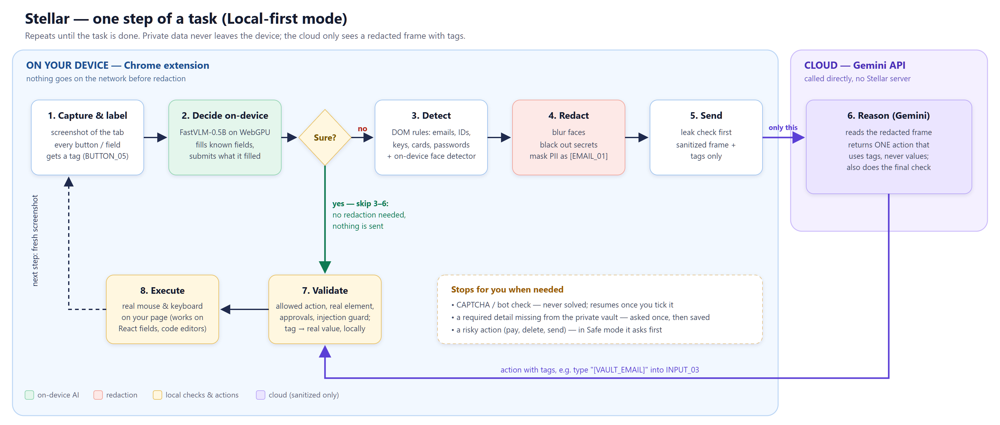
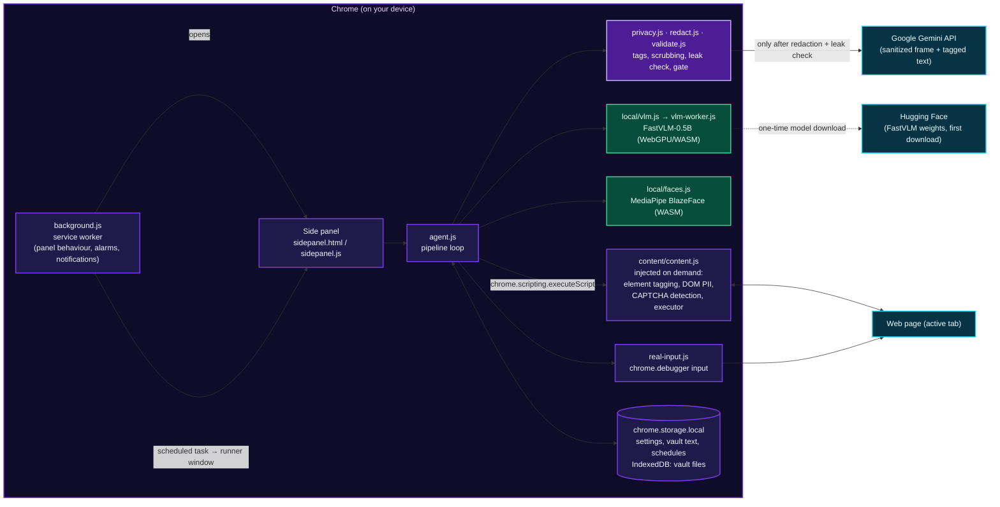

<a id="readme-top"></a>

<p align="center">
  
</p>

<p align="center">
  
</p>

<h1 align="center">Stellar: Privacy-First Visual Browser Agent</h1>

<p align="center">
  <b>A Chrome extension that does tasks on web pages for you, while your passwords, IDs, faces and personal details stay on your device.</b>
</p>

<p align="center">
  
  
  
  
  
  
  
  <br/>
  
  
  
  
  
</p>

<p align="center">
  <a href="#-about">About</a> •
  <a href="#-overview">Overview</a> •
  <a href="#-key-features">Features</a> •
  <a href="#-tech-stack">Tech stack</a> •
  <a href="#-architecture">Architecture</a> •
  <a href="#-getting-started">Getting started</a> •
  <a href="#-usage">Usage</a> •
  <a href="#-how-it-works">How it works</a> •
  <a href="#-offline-demo-site">Demo</a>
</p>

<p align="center">
  <b>Capture → Detect → Redact → Send → Reason → Validate → Execute</b><br/>
  <i>The AI sees what it needs to see, and nothing it shouldn't.</i>
</p>

<div align="center">
<table>
  <tr>
    <td align="center"><h3>7</h3><sub>pipeline stages per step</sub></td>
    <td align="center"><h3>16</h3><sub>private-data categories</sub></td>
    <td align="center"><h3>11</h3><sub>allow-listed action types</sub></td>
    <td align="center"><h3>0.5B</h3><sub>on-device vision-language model</sub></td>
    <td align="center"><h3>0</h3><sub>build steps: load it unpacked</sub></td>
  </tr>
</table>
</div>

<p align="center">
  <a href="docs/stellar-flow.svg"></a>
  <br/>
  <sub><b>Stellar: one step of a task (Local-first mode)</b> · <a href="docs/stellar-flow.svg">full-size SVG</a> · <a href="docs/how-it-works.html">one-page explainer (HTML)</a></sub>
</p>

## 🌌 About

**Stellar** is a Chrome extension that lets an AI agent use the web for you without handing your private data to the cloud. You describe a task in the side panel, such as filling in a form, comparing prices or summarising a page. Stellar works through it step by step, clicking and typing on the real page with real mouse and keyboard input.

Most visual browser agents send screenshots of your tabs to a cloud model. Those screenshots are full of things that should never leave your computer: saved passwords, card numbers, Aadhaar and PAN numbers, API keys, email addresses, other people's names, and faces. Stellar puts a **local privacy layer** in the way.

Every step runs through seven stages: capture, detect, redact, send, reason, validate and execute.
- **Detect and redact:** private data is found **on your device** using DOM rules, pattern matching, your private vault and a WebAssembly face detector. It is then blurred, blacked out or replaced with tags such as `[EMAIL_01]`.
- **Send:** a leak check scans the outgoing text, and then **only the sanitized frame** goes to Google Gemini.
- **Validate and execute:** Gemini answers with a single proposed action, and a **local validator** approves it, blocks it or asks you first. Tags turn back into real values only on your machine.

In **Local-first** mode, an on-device vision-language model (FastVLM-0.5B running on WebGPU) handles simple steps by itself, so those steps send nothing to the cloud at all.

Alongside the agent, Stellar includes a page summariser, price comparison across Indian stores, scheduled tasks written in plain language, voice input, and a private vault for your details. Every stage is shown live in the side panel, so you can see exactly what leaves your machine. It is plain JavaScript with no build step: load the folder unpacked and it runs.

## 📑 Table of Contents

- [About](#-about)
- [Overview](#-overview)
- [Key Features](#-key-features)
- [Tech Stack](#-tech-stack)
- [Architecture](#-architecture)
- [Permissions](#-permissions)
- [Project Structure](#-project-structure)
- [Getting Started](#-getting-started)
- [Usage](#-usage)
- [How It Works](#-how-it-works)
- [Offline Demo Site](#-offline-demo-site)
- [Limitations](#-limitations)
- [Contributing](#-contributing)
- [License](#-license)
- [Author](#-author)

## 🔭 Overview

### The problem

Visual browser agents work by sending screenshots of your tabs to a cloud model. Those screenshots often hold things that should never leave your computer: saved passwords, card numbers, Aadhaar and PAN numbers, API keys, email addresses, other people's names, and faces.

### The solution

Stellar is a Manifest V3 Chrome extension that puts a **local privacy layer** between the page and the model. Each step works like this:

1. The current tab is captured, and every visible interactive element gets a tag such as `[BUTTON_03]`.
2. Private data is found **on the device** using DOM rules, regexes, your private vault and a WebAssembly face detector.
3. That data is **redacted**: faces are blurred, secrets are blacked out, and other personal data is masked with semantic tags such as `[EMAIL_01]` or `[PASSWORD_01]`.
4. A **leak check** scans the outgoing text. Then **only the sanitized frame** and a scrubbed prompt go to Google Gemini.
5. Gemini proposes **one** JSON action. A **local validator** approves it, blocks it, or asks you first. Tags are turned back into real values **locally**, and the action runs on the page.

In **Local-first** mode, an on-device vision-language model (FastVLM-0.5B on WebGPU) handles the simple steps itself, like filling known fields or submitting a form it just filled. Those steps send nothing to the cloud at all.

Every stage is shown live in Chrome's side panel, so you can see exactly what leaves the machine.

## ✨ Key Features

**Privacy pipeline**

<table>
  <tr>
    <td width="33%" valign="top">🔐 <b>No network request before redaction (default)</b><br/>PII detection uses DOM rules plus on-device face detection. A <i>Snapshot</i> makes no reasoning call.</td>
    <td width="33%" valign="top">🏷️ <b>Semantic tags instead of values</b><br/>The same value keeps the same tag for the whole task, including follow-ups, so the model can still reason about "who is who".</td>
    <td width="33%" valign="top">🕶️ <b>Category-based redaction policy</b><br/>faces, signatures and private images are pixelated and blurred. Passwords, API keys, OTPs, CVVs, cards, bank details and government IDs are blacked out. Other PII is masked and labelled.</td>
  </tr>
  <tr>
    <td width="33%" valign="top">🚦 <b>Outbound leak check</b><br/>A request is blocked if any known private value appears in the outgoing text.</td>
    <td width="33%" valign="top">🛡️ <b>Local action validation</b><br/>an action-type allow-list, a check that the target is a real visible and enabled element, a loop guard, a check that tags are never put into URLs, a guard against pasting on-page secrets elsewhere, and approval prompts for risky actions.</td>
    <td width="33%" valign="top">📊 <b>Privacy report</b><br/>after each task (for example, "Hid 3 emails, 1 password and 2 names. Sent 0 private items to the cloud."). The report is also included in the JSON run export.</td>
  </tr>
</table>

**Agent capabilities**

<table>
  <tr>
    <td width="33%" valign="top">🤖 <b>Run agent</b><br/>a multi-step browser automation loop (default 15 steps, configurable up to 50) with <code>click / type / select / upload / scroll / press_key / navigate / go_back / wait / done / ask_user</code> actions.</td>
    <td width="33%" valign="top">🖱️ <b>Real mouse and keyboard</b><br/>through the Chrome debugger protocol, which works with React and Vue fields, rich-text editors and custom dropdowns. If that fails, Stellar falls back to scripted DOM events.</td>
    <td width="33%" valign="top">💻 <b>Code editors</b><br/>writes into Monaco, CodeMirror and Ace through each editor's own API when the page exposes it.</td>
  </tr>
  <tr>
    <td width="33%" valign="top">🔒 <b>Private vault</b><br/>stores <code>KEY=value</code> personal details and files (for example a résumé) that the model only sees as <code>[VAULT_EMAIL]</code> or <code>[FILE_RESUME]</code>. Files are attached to upload fields straight from IndexedDB.</td>
    <td width="33%" valign="top">📥 <b>Vault import</b><br/>from images, PDFs, <code>.docx</code>, <code>.vcf</code>, <code>.txt</code>, <code>.csv</code> and <code>.json</code>. Import runs either on-device (pdf.js, FastVLM, local parsers) or through Gemini.</td>
    <td width="33%" valign="top">🙋 <b>Asks for missing details</b><br/>If a required field needs personal data the vault doesn't have, Stellar asks you once and can save the answer to the vault.</td>
  </tr>
  <tr>
    <td width="33%" valign="top">🧩 <b>CAPTCHA handoff</b><br/>Turnstile, reCAPTCHA, hCaptcha, Arkose and Cloudflare challenge pages are detected. Stellar pauses before any model call, never clicks them, and resumes once you have solved the check.</td>
    <td width="33%" valign="top">🔓 <b>Unlocking autofilled logins</b><br/>Chrome hides saved-login values until a real click. Stellar makes one real click on a blank part of the form to release them, and never reads or sends the password.</td>
    <td width="33%" valign="top">🎛️ <b>Safe and Autopilot modes</b><br/>Safe asks before risky steps. Autopilot auto-approves them, but some checks are never auto-approved and get blocked instead.</td>
  </tr>
</table>

**Tools**

<table>
  <tr>
    <td width="50%" valign="top"><b>📝 Summarize page</b><br/>reads the page text on-device, tags private values, then asks Gemini for a plain-language summary with a <i>Watch out for</i> list. You can then ask follow-up questions about the page.</td>
    <td width="50%" valign="top"><b>⚖️ Compare prices</b><br/>opens Amazon, Flipkart and Myntra (Ajio, Meesho and Snapdeal are optional) in background tabs at the same time and reads only the product cards. It builds a cheapest-first table, with an optional budget filter and a Gemini verdict.</td>
  </tr>
  <tr>
    <td width="50%" valign="top"><b>⏰ Schedule</b><br/>turns sentences like <i>"every morning at 9, check train ticket prices"</i> into recurring <code>chrome.alarms</code> tasks. Results arrive as notifications. There is also a daily "Watch price" option for comparisons.</td>
    <td width="50%" valign="top"><b>🎤 Voice input in many languages</b><br/>live preview through Web Speech recognition. Gemini identifies the spoken language and transcribes it, and replies are read aloud with browser speech synthesis.</td>
  </tr>
</table>

**Presentation and UI**
- Task tabs, a 7-stage rail, collapsible step cards, a "Guided" pace that pauses briefly on each stage, *Follow live* scrolling, a presenter mode that blurs raw captures, a pop-out window, 13 light colour palettes plus Dark, and keyboard shortcuts.

## 🧰 Tech Stack

<p align="center">
  
</p>

| Layer | Technology | Notes |
| --- | --- | --- |
| Platform | Chrome Extension, **Manifest V3** | Side panel UI and a module service worker (`background.js`) |
| Language | Vanilla **JavaScript (ES modules)**, HTML, CSS | No framework, no bundler, no `package.json`. Runs as-is |
| Cloud reasoning | **Google Gemini** REST API (`generativelanguage.googleapis.com/v1beta`) | `generateContent` with JSON response schemas. Rotates between multiple keys and falls back to other models |
| On-device VLM | **Transformers.js 4.3.1** + **ONNX Runtime Web** | `onnx-community/FastVLM-0.5B-ONNX` in a Web Worker. Uses WebGPU, or WASM if WebGPU is unavailable |
| On-device face detection | **MediaPipe Tasks Vision** (BlazeFace short-range, ~230 KB) | WebAssembly. The model is bundled in `vendor/mediapipe/` |
| PDF parsing | **pdf.js** (`pdfjs-dist`) | Used for importing files into the vault on-device |
| Browser APIs | `chrome.sidePanel`, `scripting`, `tabs`, `debugger`, `alarms`, `notifications`, `storage`; IndexedDB; Canvas; Web Speech; `speechSynthesis`; `DecompressionStream` | |
| Demo server | Python 3 standard library (`http.server`) | Only needed for the offline demo site |

> [!NOTE]
> Exact versions and licenses of the vendored libraries are listed in [`vendor/README.md`](vendor/README.md).

## 📐 Architecture



**How the parts talk to each other**

- The **service worker** (`background.js`) is small. It makes the toolbar icon (or <kbd>Alt</kbd>+<kbd>Shift</kbd>+<kbd>S</kbd>) open the side panel, sets up scheduled-task alarms, opens a runner pop-up window when an alarm fires, and opens the result when you click a notification.
- The **side panel** is where all the logic runs. `sidepanel.js` builds the UI and wires the settings. `agent.js` runs the pipeline.
- The **content script** is *not* auto-injected. The panel injects `content/content.js` with `chrome.scripting.executeScript` and then calls `window.__stellar.handle({ op, ... })`. The supported operations include `scan`, `readtext`, `products`, `challenge`, `autofill`, `quiet-point`, `point`, `readback`, `upload`, `paste`, `focus`, `inspect`, `execute`, `overlay` and `overlay-remove`.
- **Gemini** is called directly from the panel with `fetch`. There is no Stellar backend server.

## 🔑 Permissions

| Permission | Why it is needed (from the code) |
| --- | --- |
| `sidePanel` | Shows the Stellar UI in Chrome's side panel and opens it on toolbar click |
| `tabs` | Reads the active tab's URL and status, follows new tabs and pop-ups, opens store tabs for price comparison, and navigates or goes back |
| `activeTab` | Access to the tab the user invokes Stellar on |
| `scripting` | Injects `content/content.js` on demand and runs editor-API helpers in the page's main world |
| `storage` | Stores settings, the vault text, schedules (`chrome.storage.local`) and scheduler run state (`chrome.storage.session`) |
| `debugger` | **Real mouse and keyboard input** (`Input.dispatchMouseEvent`, `Input.dispatchKeyEvent`, `Input.insertText`), used for framework-controlled fields and for unlocking autofilled logins. Chrome shows a "started debugging this browser" bar while it is attached. You can turn it off in Settings → Agent |
| `alarms` | Fires scheduled tasks |
| `notifications` | Shows the result of a scheduled task |
| Host: `<all_urls>` | Lets the agent capture, scan and act on whatever site you point it at |

> [!NOTE]
> The manifest also sets `script-src 'self' 'wasm-unsafe-eval'` so the vendored WebAssembly runtimes (MediaPipe and ONNX Runtime) can run. All code ships inside the package because MV3 does not allow remote code.

## 📂 Project Structure

<details>
<summary><b>Show the full project tree</b></summary>

```
stellarextension/
├── manifest.json              # MV3 manifest: side panel, service worker, permissions, Alt+Shift+S command
├── background.js              # Service worker: panel behaviour, schedule alarms, notification clicks
├── content/
│   └── content.js             # Injected on demand: element tagging (Set-of-Marks), DOM PII + name detection,
│                              # CAPTCHA/autofill detection, product-card reader, action executor, page overlay
├── sidepanel/
│   ├── sidepanel.html/.js     # Panel UI: task tabs, stage rail, cards, settings, approvals, tools
│   ├── sidepanel.css, theme.css  # Styles and colour palettes
│   ├── agent.js               # Capture → Detect → Redact → Send → Reason → Validate → Execute loop
│   ├── gemini.js              # Gemini REST client: JSON output, key rotation, model fallback, backoff
│   ├── prompts.js             # Detector/agent prompts, action types and JSON schemas
│   ├── privacy.js             # Region merging, semantic tags, text/URL scrubbing, leak check, tag substitution
│   ├── redact.js              # Canvas rendering: detection overlay, blur/black/mask redaction, JPEG encode
│   ├── validate.js            # Local action-validation gate (allow / confirm / block)
│   ├── real-input.js          # Real mouse/keyboard input through chrome.debugger
│   ├── settings.js            # Defaults and persisted settings (chrome.storage.local)
│   ├── report.js              # Per-task privacy report
│   ├── summary.js             # Summarize page + "Ask about this page"
│   ├── compare.js             # Multi-store price comparison
│   ├── schedules.js           # Natural-language schedule parsing, alarms, runner window
│   ├── voice.js               # Speech recognition, language identification, speech synthesis
│   ├── vault-import.js        # Extract vault fields from images, PDFs, .docx, .vcf, .csv, .json, text
│   ├── vault-files.js         # Stored vault files in IndexedDB, used for upload fields
│   ├── mic.html / mic.js      # One-time microphone permission page (the side panel can't prompt)
│   └── local/
│       ├── vlm.js             # Client for the on-device model: load, progress, auto-unload, cache check
│       ├── vlm-worker.js      # FastVLM-0.5B in a module Web Worker (WebGPU / WASM)
│       ├── planner.js         # On-device planner: candidate ranking + FastVLM choice
│       └── faces.js           # MediaPipe BlazeFace face detection over the frame and image tiles
├── vendor/                    # Vendored third-party bundles (Transformers.js, ONNX Runtime Web,
│                              # pdf.js, MediaPipe + BlazeFace model). See vendor/README.md
├── demo/                      # Offline "Orbit Cloud" demo site with fictional PII, plus serve.py
│   ├── assets/                # Face photo, scanned receipt image
│   └── samples/               # Fictional ID card PNG/PDF, résumé .docx, contact .vcf for vault import
├── docs/
│   ├── how-it-works.html      # One-page explainer
│   └── stellar-flow.png/.svg  # Pipeline diagram
└── icons/                     # Extension icons (16/32/48/128)
```

</details>

## 🚀 Getting Started

### Prerequisites

- **Google Chrome**, or another Chromium browser that supports the Side Panel API and MV3.
- A **Google Gemini API key** from [Google AI Studio](https://aistudio.google.com/apikey). You don't need one for *On-device only* mode or for a Snapshot with the default on-device detector.
- *Optional:* a GPU with **WebGPU** support for fast on-device FastVLM inference. Without it, Stellar falls back to WASM. The first model download is about **670 MB**.
- *Optional:* **Python 3**, only for serving the offline demo site.

### Installation

There is **no build step**. The repository is the unpacked extension.

```bash
git clone https://github.com/RohitMunnuru9/stellarextension.git
```

Or download the ZIP of the `main` branch from <https://github.com/RohitMunnuru9/stellarextension/archive/refs/heads/main.zip> and unzip it. Keep the folder somewhere permanent, because Chrome loads the extension from it.

### Load the extension

1. Open `chrome://extensions`.
2. Turn on **Developer mode** (top-right).
3. Click **Load unpacked** and select the folder that contains `manifest.json`.
4. Pin the **Stellar** icon. Click it, or press <kbd>Alt</kbd>+<kbd>Shift</kbd>+<kbd>S</kbd>, to open the side panel.

> [!TIP]
> **To update:** pull or replace the files, then click the reload icon on the Stellar card in `chrome://extensions`. Your settings and vault are kept in extension storage.

### Configuration

Stellar has **no `.env` file or environment variables**. All configuration lives in the panel's **Settings** (gear icon) and is saved to `chrome.storage.local` on your device:

1. Paste one or more **Gemini API keys**, separated by commas or newlines. Then click **Test keys & load models**. Keys that are rejected or rate-limited are automatically skipped for a while.
2. *Optional:* open **On-device model → Download & load** to fetch FastVLM-0.5B once. It is cached in the browser's Cache Storage.
3. *Optional:* fill the **Private vault** with `KEY=value` lines (for example `EMAIL=...`, `PHONE=...`), or use **Add file…** to import or store documents.

Main settings keys (see `sidepanel/settings.js` for all defaults):

| Key | Default | Meaning |
| --- | --- | --- |
| `apiKey` | `""` | One or more Gemini keys |
| `reasonModel` | `gemini-3.6-flash` | Model that picks actions and writes summaries |
| `detectModel` | `gemini-3.5-flash-lite` | Model for optional cloud PII detection, translation and voice |
| `detector` | `local` | `local` (DOM rules + on-device faces) or `vision` (also sends the **unredacted** frame to Gemini, for comparison) |
| `localBackup` | `localfirst` | `localfirst`, `auto` (Gemini-first with on-device fallback), `always` (on-device only), or `off` (Gemini only) |
| `runMode` | `safe` | `safe` or `autopilot` |
| `maxSteps` | `15` | Step limit per task (capped at 50) |
| `realClick` | `true` | Use real mouse and keyboard through `chrome.debugger` |
| `redactNames` | `true` | Hide people's names behind `[NAME_xx]` tags |
| `vaultExtract` | `gemini` | Vault file import: `gemini` (uploads the file) or `local` |
| `compareShops` | `amazon, flipkart, myntra` | Stores used by Compare prices |
| `pace` | `guided` | `guided` (short pause per stage) or `fast` |

> [!NOTE]
> If a model is overloaded, rate-limited or slow (>35 s), the client tries your other keys, then works through `FALLBACK_MODELS` in `sidepanel/gemini.js`, then backs off and retries.

## 📖 Usage

<!-- Screenshot placeholder: side panel showing the stage rail and a redacted frame -->

| Control | What it does |
| --- | --- |
| **Run agent** | Type a task (e.g. *"Search for wireless earbuds and open the cheapest result"*) and press **Run** or <kbd>Ctrl</kbd>+<kbd>Enter</kbd> |
| **Snapshot** | Runs Capture → Detect → Redact and shows the exact payload that *would* be sent. Makes no reasoning call |
| **Stop** | Aborts the in-flight Gemini call and stops the loop |
| **Safe / Autopilot** | Switch next to *Run agent* |
| 📝 **Summarize page** | Plain-language summary of the current page, plus *Ask about this page* follow-ups |
| ⚖️ **Compare prices** | Type a product (e.g. *boAt Airdopes 141 under 2000*) and press it |
| ⏰ **Schedule** | Type a sentence with a time (e.g. *"every weekday at 8:30 am …"*). Stellar fills in the time and days |
| 🎤 | Speak a task in any supported language |
| Presenter mode | Blurs raw captures in the panel so you can screen-share safely |
| Pop-out | Opens the panel in its own window. It drives the last-focused browser window |
| **Export run** | Downloads a JSON log of the run with sanitized frames and the privacy report |

**Keyboard:** <kbd>/</kbd> focuses the task box, <kbd>Ctrl</kbd>+<kbd>Enter</kbd> runs, and <kbd>↑</kbd>/<kbd>↓</kbd> in an empty box step through recent tasks.

**Continue a task:** a finished task shows a *Continue this task* box. The follow-up runs with the earlier steps and result as context, and tags stay the same as before.

> [!IMPORTANT]
> **Scheduled tasks:** Chrome must be running at the scheduled time. If it wasn't, the task still runs when Chrome starts, as long as that is no more than 6 hours late. The task runs in its own browser window, and the answer appears as a notification.

## 🧠 How It Works

### The seven stages

| # | Stage | Where | Implementation |
| --- | --- | --- | --- |
| 1 | **Capture** | device | `chrome.tabs.captureVisibleTab` plus a DOM scan that tags up to 150 visible interactive elements (`[BUTTON_03]`, `[INPUT_02]`, `[LINK_07]`, `[UPLOAD_01]` …) |
| 2 | **Detect** | device | Password, OTP and card fields; regexes for emails, phones, Luhn-checked cards, Aadhaar, PAN, UPI and IFSC, API keys and JWTs; your vault values; people's names from profile links and labels; and **MediaPipe BlazeFace** over the whole frame, each visible image and overlapping tiles of those images. *Optional:* the Gemini vision detector |
| 3 | **Redact** | device | Canvas rendering: blur (faces, images, signatures), solid black (credentials and IDs), dark mask (other PII), each stamped with its tag |
| 4 | **Send** | → cloud | Sanitized JPEG + scrubbed prompt (element labels, URL with query values removed, history). Blocked if the leak check finds any known value |
| 5 | **Reason** | cloud / device | Gemini returns `{observation, thought, status, action}` that matches `ACTION_SCHEMA`. In some modes FastVLM decides instead |
| 6 | **Validate** | device | `validate.js` returns `allow`, `confirm` or `block` (see below) |
| 7 | **Execute** | device | Real input through the debugger, or scripted DOM events. Follows new tabs and pop-ups, waits for the page to settle, then loops |

### Local validation gate (`sidepanel/validate.js`)

- The action type must be on the allow-list, and the target must be an element from **this turn's** scan that is still attached, visible and enabled.
- Targets inside a CAPTCHA are always blocked. Clicking a file input is blocked, because the `upload` action must be used instead.
- Tags in `type` text are resolved **locally**. Unknown tags are blocked.
- `navigate` must be `http(s)` and **may not contain any tag** (exfiltration guard).
- If the same action is repeated three times in a row, or tried twice in recent steps without progress, it is blocked.
- Risky labels (pay, delete, submit, send, …), vault fills and uploads need confirmation in Safe mode.
- Pasting an on-page credential or ID into an ordinary (non-secret) field is a *hard* confirm, which is **blocked in Autopilot**.

### Local-first decisions (`sidepanel/local/planner.js`)

A 0.5B model can't plan a whole task on its own. So the extension does the structured part itself:

1. It ranks candidate actions using word overlap with the task, the vault fields each label asks for, the form state, and submit-after-fill ordering.
2. It treats a step as *confident* only when the value is fully determined: a vault field, a search term from the task, a message the task states, or a matching dropdown option. Submitting a form it has just filled also counts.
3. Otherwise it asks FastVLM to pick from the top five candidates on the labelled frame. In Local-first mode, the ranking and the model must agree.

Links, search results and menus are left to Gemini, and Gemini always does the final check on a redacted frame. If FastVLM isn't downloaded yet, Local-first quietly hands every step to Gemini.

### Gemini client (`sidepanel/gemini.js`)

- Each request uses `responseMimeType: application/json` with a response schema. For Gemini 3 models, Stellar requests `thinkingLevel: "low"` and drops that setting if the model rejects it.
- Several keys are supported. A rejected key (401/403) is skipped for an hour. Keys that are rate-limited or overloaded are skipped for that model only, for as long as Google's `RetryInfo` says.
- API keys are scrubbed from error messages before they reach the UI.

## 🎮 Offline Demo Site

`demo/` is a fictional "Orbit Cloud" web app that works fully offline. It has pages for every feature: names, emails and a face photo; PAN, Aadhaar and card details; a scanned receipt image; a page with **fake** API keys and a planted prompt injection; long forms with required fields; a help-centre search; and a simulated bot check. The `demo/samples/` folder has fictional files for testing vault import.

Serve it from the repository root:

```bash
python -m http.server 8765
# then open http://localhost:8765/demo/
```

Or use the bundled script, which serves the `demo/` folder at both `/` and `/demo/` on port 8765:

```bash
python demo/serve.py
```

> [!TIP]
> Start from the **Demo guide** page. You can also open `demo/index.html` as a `file://` URL if you turn on **Allow access to file URLs** for the extension.

## 🚧 Limitations

- Chrome doesn't let extensions run on `chrome://` pages, the Chrome Web Store or the New Tab page. On a New Tab, Stellar opens google.com first.
- The content script is injected into the top frame only, so elements inside cross-origin iframes are not tagged. On-device face detection still covers what is visible in the screenshot.
- Canvas-only apps expose few DOM elements to act on.
- CAPTCHAs and bot checks are never solved. You must complete them yourself.
- **Cloud vision** detection mode, Gemini-based vault import and voice language identification send raw data (the unredacted frame, the document, or the audio clip) to Google. Chrome's speech recogniser also sends audio to Google's speech service.
- A loaded FastVLM model uses a lot of memory. It is unloaded after a configurable idle period (10 minutes by default).
- There is no automated test suite in the repository.

## 🤝 Contributing

Contributions are welcome.

1. Fork the repository and create a feature branch.
2. Make your changes. There is no build step, so edit the files directly.
3. Reload the extension in `chrome://extensions` and test against real sites and the offline demo (`demo/`).
4. Keep the privacy guarantees intact. Nothing should reach the network before redaction and the leak check, unless the user has explicitly opted in.
5. Open a pull request that describes the change and how you tested it.

## 📜 License

The project itself has no license specified (there is no `LICENSE` file at the repository root).

Vendored third-party libraries keep their own licenses: Transformers.js and pdf.js are Apache-2.0 (see `vendor/LICENSE.transformers` and `vendor/LICENSE.pdfjs`). [`vendor/README.md`](vendor/README.md) lists ONNX Runtime Web as MIT and MediaPipe as Apache-2.0.

## 👤 Author

**Rohit Munnuru**: [github.com/RohitMunnuru9](https://github.com/RohitMunnuru9)

<p align="center">
  Built with ❤️ by <a href="https://github.com/RohitMunnuru9"><b>Rohit Munnuru</b></a> · team <b>STELLAR_6</b><br/>
  <sub>If this project helped or impressed you, drop a ⭐ — it really helps!</sub>
</p>

<p align="center"><a href="#readme-top">⬆ Back to top</a></p>

<p align="center">
  
</p>
